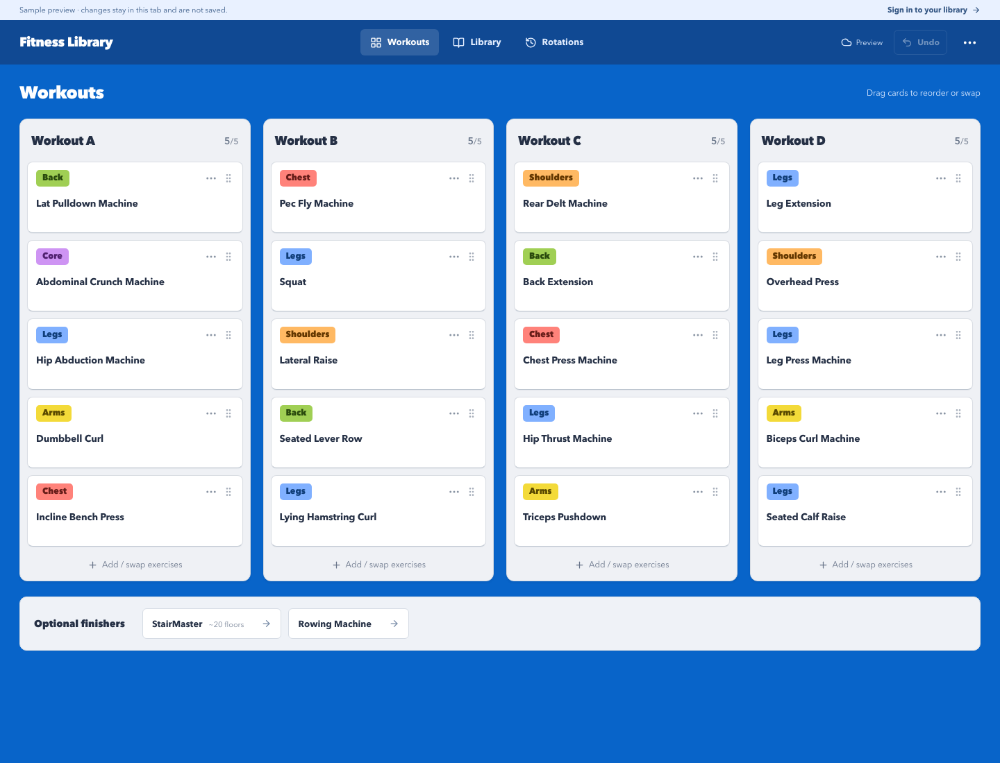
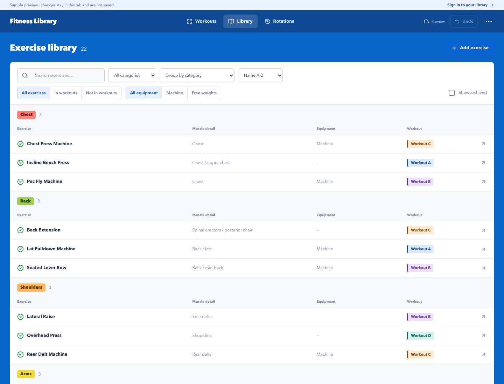
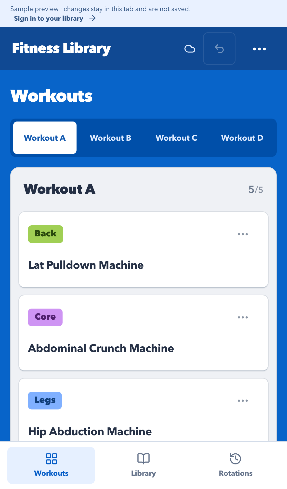

# Fitness Library

A personal exercise library and workout planner built with React, TypeScript, and Firebase. Arrange a four-workout rotation, keep track of substitutions, and use the same library on your computer and phone.

[Live app](https://fitness-library-e4d70.web.app) · [Try the sample library](https://fitness-library-e4d70.web.app/workouts?preview=1)

The live app is private to its owner. The sample library needs no account; edits stay in the tab and reset on refresh.

## Screenshots

### Workout board



### Exercise library



<details>
<summary>Mobile view</summary>
<br>

</details>

All screenshots show the built-in sample library, not account data.

## Features

- Four workouts, five strength slots each, with drag-and-drop reordering and explicit swaps.
- Color-coded muscle categories and A–D workout badges.
- Search, grouping, and visible filters; green checks identify exercises already in the program.
- Simple exercise editing, archive/restore, notes, and optional cardio finishers.
- Rotation history, review reminders, and Undo in the top-right toolbar. Save confirmations appear briefly in the header; no floating overlay covers the library.
- Google sign-in and cloud saving across devices, with revision checks for conflicting edits.
- Installable PWA with offline viewing and versioned JSON backup/restore.

This is a planning tool. Sets, weights, reps, and completed-session logging are outside the current scope.

## Run locally

Requires **Node.js 24 LTS** and npm.

```sh
npm ci
npm run dev
```

Open [the local sample library](http://127.0.0.1:5173/workouts?preview=1). Sample mode works without Firebase configuration.

## Connect your own Firebase project

1. Create a Firebase project on the free Spark plan.
2. Create the **Standard edition** Firestore database named `(default)`, initially in production mode.
3. Enable **Google** in Authentication and add `localhost` to Authorized domains.
4. Register a web app and copy its web configuration.
5. Create your local environment file:

   ```sh
   cp .env.example .env.local
   ```

6. Fill in the web configuration values and `VITE_OWNER_EMAIL` in `.env.local`. Use the Google account that should own the library.
7. Generate your local project selection and database rules, then deploy:

   ```sh
   npm run firebase:configure
   npx firebase login
   npm run deploy
   ```

The configure script generates ignored `.firebaserc` and `firestore.rules` files from your environment and the tracked rules template. Deployment uses Firebase **Hosting**, not App Hosting, and does not require a paid plan for these features within their free quotas. Add your hosted domain to Authentication's Authorized domains if needed.

On first authorized sign-in, the app seeds 22 exercise entries and the original A–D assignments only if the workspace is missing.

## Configuration and privacy

- `.env.local`, generated owner-specific rules, project selection, build output, local logs, backups, and the original personal project brief are excluded from Git.
- Never put service-account keys, administrator credentials, or login tokens in this project or in `VITE_*` variables. Vite includes those variables in the browser build.
- Firebase **web** configuration is public connection information, not a database password. Access is enforced by verified owner identity and Firestore rules, not by hiding the web API key. See [Firebase's API-key guidance](https://firebase.google.com/docs/projects/api-keys).
- Review the rules before deploying. They restrict reads and writes to the configured verified email and the signed-in user's own UID path; other paths are denied.
- Previously loaded data is cached locally for offline viewing. Editing requires a server transaction. Sign out on shared devices to clear the viewing copy.
- Keep a JSON export for backups. The application does not enable paid automatic database backups.

## Development

```sh
npm test
npm run build
npx playwright install chromium
npm run test:e2e
```

Database-rule tests require **Java 21+**:

```sh
npm run test:rules
```

Rules tests use a local emulator, a demo project ID, and a synthetic owner email. Browser tests use sample data. Neither needs access to the production library.

```sh
npm run format
```

See [architecture notes](docs/architecture.md) for the data model, history, conflict handling, and offline behavior. Authentication and installation on a physical iPhone should also be checked after configuring your own deployment.
